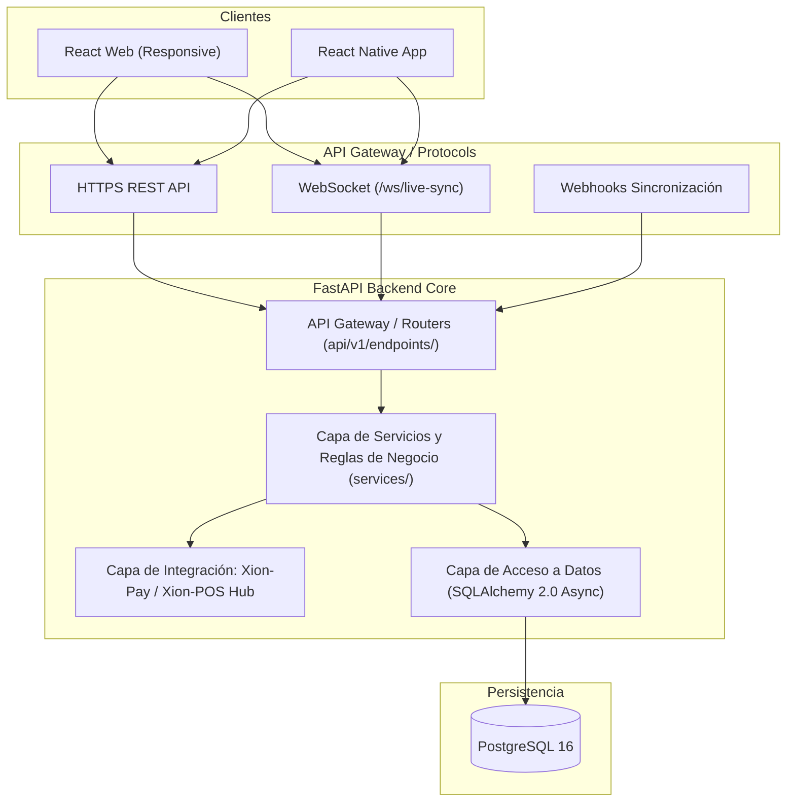

# Arquitectura y Estructura (`02_architecture.md`)

---

## 1. Patrón Arquitectónico

El backend sigue una **Arquitectura en Capas Limpias (Clean Layered Architecture)** desacoplada sobre FastAPI, orientada a dominios de negocio. El frontend web utiliza una arquitectura modular basada en componentes funcionales (React + Vite), mientras que la versión móvil aprovecha React Native bajo la misma arquitectura de servicios y modelos.



---

## 2. Árbol de Directorios Objetivo

```text
xion-manager/
├── docker/
│   ├── backend.Dockerfile
│   ├── frontend.Dockerfile
│   └── nginx.conf
├── docker-compose.yml
├── backend/
│   ├── alembic/
│   ├── app/
│   │   ├── api/
│   │   │   ├── v1/
│   │   │   │   ├── endpoints/
│   │   │   │   │   ├── auth.py
│   │   │   │   │   ├── dashboard.py
│   │   │   │   │   ├── branches.py
│   │   │   │   │   ├── cash_registers.py
│   │   │   │   │   ├── inventory.py
│   │   │   │   │   ├── purchases.py
│   │   │   │   │   ├── users.py
│   │   │   │   │   ├── audit.py
│   │   │   │   │   ├── reports.py
│   │   │   │   │   ├── notifications.py
│   │   │   │   │   ├── billing.py
│   │   │   │   │   └── sync.py
│   │   │   │   └── api_router.py
│   │   │   └── deps.py
│   │   ├── core/
│   │   │   ├── config.py
│   │   │   ├── database.py
│   │   │   ├── security.py
│   │   │   └── exceptions.py
│   │   ├── models/
│   │   │   ├── user.py
│   │   │   ├── branch.py
│   │   │   ├── cash_register.py
│   │   │   ├── inventory.py
│   │   │   ├── purchase.py
│   │   │   ├── sale_sync.py
│   │   │   ├── audit.py
│   │   │   └── billing.py
│   │   ├── schemas/
│   │   │   ├── user.py
│   │   │   ├── branch.py
│   │   │   ├── cash_register.py
│   │   │   ├── inventory.py
│   │   │   ├── billing.py
│   │   │   └── sync.py
│   │   ├── services/
│   │   │   ├── branch_service.py
│   │   │   ├── cash_service.py
│   │   │   ├── inventory_service.py
│   │   │   ├── billing_service.py
│   │   │   ├── sync_service.py
│   │   │   └── audit_service.py
│   │   └── main.py
│   ├── pyproject.toml
│   └── requirements.txt
├── frontend-web/
│   ├── public/
│   ├── src/
│   │   ├── assets/
│   │   ├── components/
│   │   │   ├── ui/
│   │   │   ├── dashboard/
│   │   │   ├── branches/
│   │   │   ├── cash-registers/
│   │   │   ├── inventory/
│   │   │   ├── billing/
│   │   │   └── shared/
│   │   ├── hooks/
│   │   ├── layouts/
│   │   ├── pages/
│   │   ├── services/
│   │   ├── stores/
│   │   ├── types/
│   │   └── App.tsx
│   ├── package.json
│   ├── tailwind.config.js
│   └── tsconfig.json
└── mobile-app/
    ├── src/
    │   ├── components/
    │   ├── navigation/
    │   ├── screens/
    │   ├── services/
    │   └── stores/
    ├── package.json
    └── app.json
```

---

## 3. Responsabilidad de Componentes

* **`api/v1/endpoints/`:** Controladores puramente HTTP y WebSocket. Reciben la petición, parsean esquemas con Pydantic, invocan la capa de servicio y devuelven el código HTTP correspondiente. No contienen lógica SQL ni validaciones complejas de negocio.
* **`services/`:** Contenedores de la lógica de dominio (cálculo de límites de cajas, ejecución de traslados, validación del semáforo de facturación, deducción de stock).
* **`models/`:** Definiciones declarativas de SQLAlchemy 2.0 que mapean exactamente las tablas relacionales de PostgreSQL.
* **`schemas/`:** Modelos de validación y serialización de Pydantic v2 (contratos de entrada y salida).
* **`core/`:** Configuración global (`pydantic-settings`), conexión y pool de base de datos asíncrono, y middleware de autenticación/autorización.
* **`frontend-web/ & mobile-app/`:** Vistas y componentes con estado reactivo, desacoplados del backend mediante una capa unificada de clientes de API (`services/api.ts`).

---

## 4. Protocolos y Canales de Comunicación

* **REST HTTPS:** Comunicación estándar para todas las operaciones CRUD, autenticación, consultas de reportería y llamadas al checkout.
* **WebSockets (`/ws/live-sync`):** Canal bidireccional en tiempo real para:
  1. Notificaciones instantáneas al propietario sobre cierres de turno o descuadres de caja.
  2. Telemetría de estado de conexión de las terminales Xion-POS.
* **Webhooks de Sincronización e Ingesta:** Endpoints seguros firmados criptográficamente para recibir lotes de ventas offline desde Xion-POS cuando recuperan conectividad.
