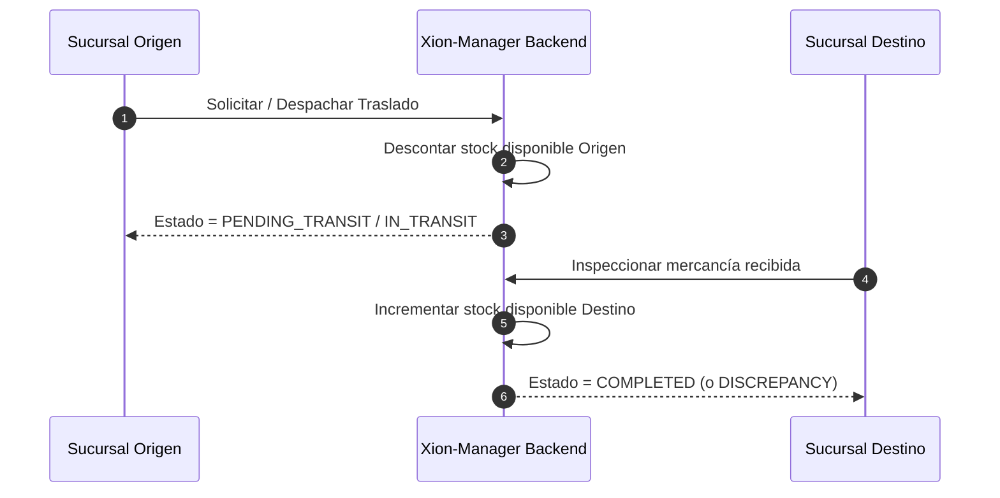

# Especificación Modular y Requerimientos (`03_modules.md`)

---

## 1. Listado de Módulos

1. Módulo de Panel Principal (Dashboard)
2. Módulo de Sucursales y Cajas
3. Módulo de Inventario y Traslados
4. Módulo de Compras y Proveedores
5. Módulo de Usuarios y Aprobaciones
6. Módulo de Auditoría y Bitácora de Cajas
7. Módulo de Reportes
8. Módulo de Notificaciones
9. Módulo de Checkout Interno, Facturación y Estado de Cuenta

---

## 2. Especificación Detallada por Módulo

### 2.1. Módulo de Panel Principal (Dashboard)

* **Requerimientos Funcionales:**
  * Presentar tarjetas con totales consolidados: Ventas Totales ($ / moneda local), Ingresos Brutos, Margen de Ganancia Promedio y Cantidad de Transacciones del día, semana y mes.
  * Selector de desglose jerárquico: Negocio Global $\rightarrow$ Por Sucursal $\rightarrow$ Por Caja Registradora individual.
  * Gráfico interactivo de tendencia horaria y volumen de ventas comparativo por sede.
* **Flujo de Datos:** El cliente solicita `/api/v1/dashboard/metrics?branch_id=&from=&to=`. El servicio consolida los datos de ventas sincronizadas en PostgreSQL y retorna los agregados precomputados en menos de 200 ms.
* **UI Concept:** Encabezado con selector de rango de fechas y filtro rápido de sede. Cuadrícula de 4 KPIs superiores con indicadores visuales de variación porcentual (+/- %). Gráfico de líneas principal y tabla inferior que lista cada sucursal con su estado, venta del día y caja con mayor recaudación.

---

### 2.2. Módulo de Sucursales y Cajas

* **Requerimientos Funcionales:**
  * Crear, editar y deshabilitar sucursales.
  * Asignar nombre descriptivo, dirección fiscal y geolocalización en mapa interactivo de Google Maps (latitud y longitud automáticas mediante pin interactivo o buscador de direcciones).
  * Conmutador de visualización entre vista de tarjetas visuales (*Card View*) y tabla ordenada (*List View*).
  * Control del límite de cajas por sucursal: el sistema no permite agregar cajas registradoras si la suma total de cajas activas del negocio iguala el límite contratado en el plan.
  * **Activación y Vinculación de Terminales ("Flujo Smart TV"):**
    * Botón «Vincular Nueva Caja» en el panel web/móvil: el dueño introduce el código de 6 caracteres (o escanea el QR) proyectado en la pantalla de la máquina de caja.
    * Asignación inmediata de nombre y sucursal a la terminal autorizada.
    * Emisión de `Device Token` criptográfico exclusivo para la máquina física sin exponer la contraseña de administrador.
    * **Revocación Remota con 1 Clic:** Capacidad del dueño de revocar el acceso y desvincular inmediatamente el equipo físico en caso de pérdida, baja o despido.
  * Vista de Detalle de Sucursal:
    * Asignación de Gerente o Encargado principal.
    * Panel de control de cajas registradoras pertenecientes a esa sucursal.
  * Vista de Detalle de Caja:
    * Asignar usuarios/operadores autorizados para abrir y cobrar en la caja (con configuración de PIN de cajero de 4 a 6 dígitos).
    * Configurar métodos de pago admitidos (Efectivo, Tarjeta, Pago Móvil, etc.).
    * Métricas de la caja (ventas acumuladas, turnos abiertos, estado de vinculación física).
    * Acceso directo a la **Bitácora Auditable** de la caja (registro de turnos, aperturas, arqueos ciegos y cierres de sesión).
* **Flujo de Datos:** Al vincular la caja, el backend valida el cupo del plan mediante `billing_service.validate_cash_register_limit(business_id)` y emite el `device_token` al cliente WebSocket/polling del terminal. Al pulsar "Guardar Caja", persiste el registro y vincula a los cajeros autorizados con sus hashes de PIN.
* **UI Concept:** Pantalla principal con botones de alternancia [Tarjeta] / [Lista], botón "Nueva Sucursal" y botón prioritario **«Vincular Terminal (Smart TV)»**. En la tarjeta de caja: indicador de estado de vinculación del equipo (🟢 Vinculada / 🟡 Pendiente de código), cajero en turno, y botón de acción rápida para revocar acceso remotamente.

---

### 2.3. Módulo de Inventario y Traslados

* **Requerimientos Funcionales:**
  * Visualización de inventario por sucursal: stock actual, stock mínimo, precio de venta y costo promedio.
  * Generación de Traslados de Inventario: salida de stock desde sucursal origen a sucursal destino.
  * Flujo de dos pasos: Sucursal origen despacha (descuenta de stock disponible y marca *En Tránsito*) $\rightarrow$ Sucursal destino inspecciona y confirma recepción (ingresa a stock disponible). Posibilidad de registrar incidencias o discrepancias en la recepción.
* **Flujo de Datos:**

* **UI Concept:** Selector de sucursal en la parte superior. Tabla con buscador rápido por código de barra o nombre del producto, badge con semáforo de existencias (Verde: Óptimo, Amarillo: Por agotar, Rojo: Agotado). Botón destacado "Nuevo Traslado entre Sedes" que abre un modal guiado paso a paso.

---

### 2.4. Módulo de Compras y Proveedores

* **Requerimientos Funcionales:**
  * Registro de facturas de compra a proveedores asignadas directamente a una sucursal destino.
  * Incremento automático del inventario y actualización del costo promedio ponderado de los productos.
  * Historial de compras filtrable por fecha, proveedor y sucursal.
* **UI Concept:** Formulario intuitivo con autocompletado de productos, selección de proveedor, sucursal de recepción y desglose de subtotales e impuestos.

---

### 2.5. Módulo de Usuarios y Aprobaciones

* **Requerimientos Funcionales:**
  * Crear y administrar usuarios con roles específicos (Dueño, Administrador, Gerente de Sucursal, Supervisor, Cajero, Auditor).
  * Flujo de Aprobación de Usuarios: Registro inicial en estado *Pendiente de Autorización*. El propietario o administrador debe aprobarlo activamente antes de que pueda iniciar sesión en el Manager o en Xion-POS.
  * Asignación de sucursales permitidas para cada usuario.
* **UI Concept:** Tabla con filtros de estado (*Activo*, *Pendiente de Aprobación*, *Inactivo*). En usuarios pendientes, se despliegan acciones rápidas destacadas: "Aprobar Acceso" o "Rechazar".

---

### 2.6. Módulo de Auditoría y Bitácora de Cajas

* **Requerimientos Funcionales:**
  * Registro central de auditoría del sistema: cambios de configuración, creación de usuarios, ajustes de inventario y traslados.
  * Bitácora Auditable de Caja: línea de tiempo de cada terminal POS que refleja: hora de apertura de turno, monto inicial en fondo de caja, arqueos intermedios, cierres de turno, diferencias declaradas (sobrantes/faltantes) y cajero responsable.
* **UI Concept:** Línea de tiempo cronológica con filtros por sucursal, caja y fecha. Cada evento contiene un badge con el tipo de acción y un visor expandible de detalles con los valores anteriores y posteriores.

---

### 2.7. Módulo de Reportes

* **Requerimientos Funcionales:**
  * Generación de reportes ejecutivos: Ventas por Período, Rendimiento por Sucursal, Arqueos de Caja, Rotación de Inventario y Movimientos de Traslado.
  * Exportación nativa a formatos PDF estructurado y Excel/CSV.
* **UI Concept:** Centro de reportes con tarjetas descriptivas de cada informe, selectores de rango y botón de descarga con barra de progreso.

---

### 2.8. Módulo de Notificaciones

* **Requerimientos Funcionales:**
  * Alertas en tiempo real dentro de la aplicación (in-app) y notificaciones push en móviles ante eventos clave: caja con descuadre mayor al umbral permitido, stock bajo crítico, nueva solicitud de usuario pendiente de aprobación y proximidad de vencimiento del plan.
* **UI Concept:** Campana de notificaciones en el encabezado con contador de mensajes no leídos y panel lateral deslizante (*drawer*) categorizado por severidad (*Informativo*, *Atención*, *Urgente*).

---

### 2.9. Módulo de Checkout Interno, Facturación y Estado de Cuenta (Xion-Pay)

* **Requerimientos Funcionales:**
  * **Renovación y Selección de Ciclo:** Selector claro para pagar el mes en curso o aplicar a planes semestrales (ej. 10% descuento) o anuales (ej. 20% descuento).
  * **Ampliación de Capacidad (Upgrades & Add-ons):** Botón para cambiar a un plan superior o añadir cajas adicionales de forma individual, calculando dinámicamente el monto prorrateado antes de ejecutar el cobro.
  * **Métodos de Pago Soportados:**
    * *Automático:* Pasarela integrada con tarjeta de débito/crédito y liquidación inmediata.
    * *Reporte de Pago Directo:* Despliegue de cuentas bancarias corporativas (Pago Móvil, transferencias bancarias nacionales e internacionales en divisas). Formulario con: banco emisor, fecha de la operación, número de referencia bancaria, monto transferido y carga obligatoria del comprobante digital (imagen o PDF).
  * **Mi Estado de Cuenta y Consumo:**
    * *Resumen del Plan Actual:* Nombre del plan activo, fecha exacta de corte y contador regresivo en días restantes.
    * *Barra de Uso de Recursos:* Barra gráfica de progreso que muestra el consumo contratado vs. utilizado:
      * Sucursales: e.g., "1 de 2 sucursales creadas".
      * Cajas: e.g., "3 de 4 cajas registradoras activas".
    * *Semáforo Operativo:* Indicador visual con etiqueta amigable:
      * **Verde (Al día):** Servicio activo con normalidad.
      * **Amarillo (Por vencer):** Menos de 5 días para la fecha de corte.
      * **Naranja (En período de gracia):** Factura vencida; servicio activo con aviso preventivo (duración configurable, ej. 3 días).
      * **Rojo (Suspendido):** Suscripción congelada; sincronización bloqueada hasta regularizar el pago.
* **UI Concept:** Pantalla limpia dividida en dos paneles: a la izquierda, la tarjeta "Salud de tu Cuenta" con el semáforo visual en badge brillante, contador en días, las barras de progreso de recursos y el desglose de uso. A la derecha, el panel interactivo "Planes y Mejoras" con selectores de ciclo de facturación, contador de add-ons de cajas con cálculo de precio en tiempo real y selector de método de pago (Pestaña "Tarjeta Inmediata" o "Reportar Transferencia / Pago Móvil").
