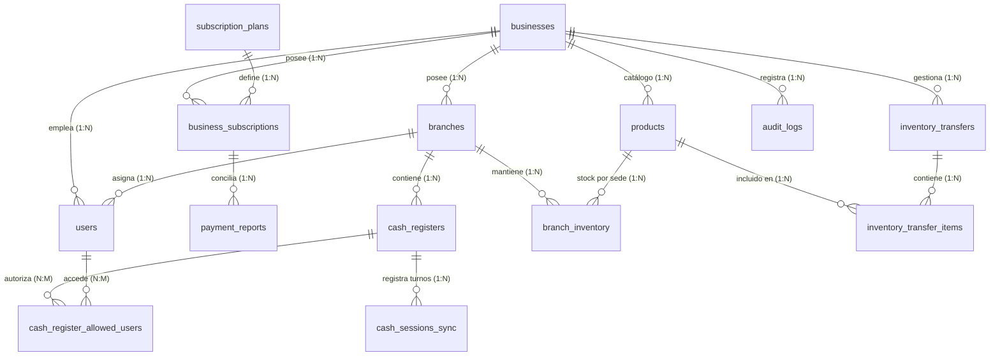

# Modelo y Estado de Datos (`04_data_model.md`)

---

## 1. Motor de Base de Datos

* **PostgreSQL 16+** con soporte para tipos de datos nativos `UUID`, `JSONB`, `TIMESTAMP WITH TIME ZONE` e índices GIN/B-Tree.

---

## 2. Diagrama de Entidad-Relación (ER)



---

## 3. Esquema SQL Completo (PostgreSQL 16)

```sql
-- Extensión para generación de UUIDs
CREATE EXTENSION IF NOT EXISTS "uuid-ossp";

-- 1. Negocios / Propietarios (Tenants)
CREATE TABLE businesses (
    id UUID PRIMARY KEY DEFAULT uuid_generate_v4(),
    legal_name VARCHAR(150) NOT NULL,
    trade_name VARCHAR(150) NOT NULL,
    tax_id VARCHAR(50) UNIQUE NOT NULL,
    phone VARCHAR(30) NOT NULL,
    email VARCHAR(100) UNIQUE NOT NULL,
    is_active BOOLEAN NOT NULL DEFAULT TRUE,
    created_at TIMESTAMP WITH TIME ZONE DEFAULT NOW(),
    updated_at TIMESTAMP WITH TIME ZONE DEFAULT NOW()
);

-- 2. Planes de Suscripción
CREATE TABLE subscription_plans (
    id UUID PRIMARY KEY DEFAULT uuid_generate_v4(),
    code VARCHAR(50) UNIQUE NOT NULL,
    name VARCHAR(100) NOT NULL,
    description TEXT,
    max_branches INT NOT NULL DEFAULT 1,
    max_cash_registers INT NOT NULL DEFAULT 1,
    price_monthly NUMERIC(12, 2) NOT NULL,
    price_semiannual NUMERIC(12, 2) NOT NULL,
    price_annual NUMERIC(12, 2) NOT NULL,
    is_active BOOLEAN NOT NULL DEFAULT TRUE,
    created_at TIMESTAMP WITH TIME ZONE DEFAULT NOW()
);

-- 3. Suscripción Activa y Estado de Cuenta del Negocio
CREATE TABLE business_subscriptions (
    id UUID PRIMARY KEY DEFAULT uuid_generate_v4(),
    business_id UUID NOT NULL REFERENCES businesses(id) ON DELETE CASCADE,
    plan_id UUID NOT NULL REFERENCES subscription_plans(id),
    billing_cycle VARCHAR(20) NOT NULL CHECK (billing_cycle IN ('MONTHLY', 'SEMIANNUAL', 'ANNUAL')),
    extra_cash_registers INT NOT NULL DEFAULT 0,
    status VARCHAR(20) NOT NULL CHECK (status IN ('ACTIVE', 'EXPIRING_SOON', 'GRACE_PERIOD', 'SUSPENDED')),
    starts_at TIMESTAMP WITH TIME ZONE NOT NULL,
    expires_at TIMESTAMP WITH TIME ZONE NOT NULL,
    grace_period_until TIMESTAMP WITH TIME ZONE,
    auto_renew BOOLEAN NOT NULL DEFAULT TRUE,
    created_at TIMESTAMP WITH TIME ZONE DEFAULT NOW(),
    updated_at TIMESTAMP WITH TIME ZONE DEFAULT NOW()
);

-- 4. Reportes de Pago Directo y Transacciones de Facturación
CREATE TABLE payment_reports (
    id UUID PRIMARY KEY DEFAULT uuid_generate_v4(),
    business_id UUID NOT NULL REFERENCES businesses(id) ON DELETE CASCADE,
    subscription_id UUID NOT NULL REFERENCES business_subscriptions(id),
    payment_method_type VARCHAR(30) NOT NULL CHECK (payment_method_type IN ('CARD_AUTOMATIC', 'PAGO_MOVIL', 'BANK_TRANSFER', 'CASH_USD')),
    issuing_bank VARCHAR(100),
    payment_date DATE NOT NULL,
    reference_number VARCHAR(100),
    amount NUMERIC(12, 2) NOT NULL,
    currency VARCHAR(10) NOT NULL DEFAULT 'USD',
    receipt_url TEXT,
    approval_status VARCHAR(20) NOT NULL DEFAULT 'PENDING' CHECK (approval_status IN ('PENDING', 'APPROVED', 'REJECTED')),
    verified_by_user_id UUID,
    verified_at TIMESTAMP WITH TIME ZONE,
    created_at TIMESTAMP WITH TIME ZONE DEFAULT NOW()
);

-- 5. Sucursales
CREATE TABLE branches (
    id UUID PRIMARY KEY DEFAULT uuid_generate_v4(),
    business_id UUID NOT NULL REFERENCES businesses(id) ON DELETE CASCADE,
    name VARCHAR(120) NOT NULL,
    address TEXT NOT NULL,
    latitude DOUBLE PRECISION,
    longitude DOUBLE PRECISION,
    phone VARCHAR(30),
    manager_user_id UUID,
    is_active BOOLEAN NOT NULL DEFAULT TRUE,
    created_at TIMESTAMP WITH TIME ZONE DEFAULT NOW(),
    updated_at TIMESTAMP WITH TIME ZONE DEFAULT NOW()
);

-- 6. Cajas Registradoras (Terminales de Cobro)
CREATE TABLE cash_registers (
    id UUID PRIMARY KEY DEFAULT uuid_generate_v4(),
    branch_id UUID NOT NULL REFERENCES branches(id) ON DELETE CASCADE,
    business_id UUID NOT NULL REFERENCES businesses(id) ON DELETE CASCADE,
    name VARCHAR(80) NOT NULL,
    hardware_uuid VARCHAR(150),
    pairing_code VARCHAR(10),                       -- Código Smart TV de 6 caracteres (ej: X9-B42)
    pairing_code_expires_at TIMESTAMP WITH TIME ZONE, -- Expiración del código (15 min)
    device_token_hash VARCHAR(255),                 -- Hash del token asignado a la máquina física
    device_paired BOOLEAN NOT NULL DEFAULT FALSE,   -- Indica si la máquina física fue aprobada por el dueño
    paired_at TIMESTAMP WITH TIME ZONE,             -- Fecha/hora de vinculación
    latitude NUMERIC(10, 6),
    longitude NUMERIC(10, 6),
    location_name VARCHAR(150),
    is_active BOOLEAN NOT NULL DEFAULT TRUE,
    created_at TIMESTAMP WITH TIME ZONE DEFAULT NOW(),
    updated_at TIMESTAMP WITH TIME ZONE DEFAULT NOW(),
    CONSTRAINT uq_branch_register_name UNIQUE(branch_id, name)
);

-- 7. Usuarios del Sistema
CREATE TABLE users (
    id UUID PRIMARY KEY DEFAULT uuid_generate_v4(),
    business_id UUID NOT NULL REFERENCES businesses(id) ON DELETE CASCADE,
    branch_id UUID REFERENCES branches(id) ON DELETE SET NULL,
    email VARCHAR(120) UNIQUE NOT NULL,
    hashed_password VARCHAR(255) NOT NULL,
    cashier_pin_hash VARCHAR(255),                  -- Hash seguro (Bcrypt/Argon2) del PIN numérico (4-6 dígitos)
    full_name VARCHAR(150) NOT NULL,
    phone VARCHAR(30),
    role VARCHAR(30) NOT NULL CHECK (role IN ('OWNER', 'ADMIN', 'BRANCH_MANAGER', 'SUPERVISOR', 'CASHIER', 'AUDITOR')),
    approval_status VARCHAR(20) NOT NULL DEFAULT 'PENDING' CHECK (approval_status IN ('PENDING', 'APPROVED', 'REJECTED')),
    is_active BOOLEAN NOT NULL DEFAULT TRUE,
    created_at TIMESTAMP WITH TIME ZONE DEFAULT NOW(),
    updated_at TIMESTAMP WITH TIME ZONE DEFAULT NOW()
);

-- 8. Relación Muchos a Muchos: Usuarios Permitidos por Caja
CREATE TABLE cash_register_allowed_users (
    cash_register_id UUID NOT NULL REFERENCES cash_registers(id) ON DELETE CASCADE,
    user_id UUID NOT NULL REFERENCES users(id) ON DELETE CASCADE,
    PRIMARY KEY (cash_register_id, user_id)
);

-- 9. Catálogo de Productos Centralizado
CREATE TABLE products (
    id UUID PRIMARY KEY DEFAULT uuid_generate_v4(),
    business_id UUID NOT NULL REFERENCES businesses(id) ON DELETE CASCADE,
    barcode VARCHAR(80),
    sku VARCHAR(80),
    name VARCHAR(150) NOT NULL,
    description TEXT,
    cost_price NUMERIC(12, 4) NOT NULL DEFAULT 0.00,
    sale_price NUMERIC(12, 4) NOT NULL,
    min_stock_alert INT NOT NULL DEFAULT 5,
    is_active BOOLEAN NOT NULL DEFAULT TRUE,
    created_at TIMESTAMP WITH TIME ZONE DEFAULT NOW(),
    updated_at TIMESTAMP WITH TIME ZONE DEFAULT NOW(),
    CONSTRAINT uq_business_barcode UNIQUE(business_id, barcode)
);

-- 10. Inventario por Sucursal
CREATE TABLE branch_inventory (
    id UUID PRIMARY KEY DEFAULT uuid_generate_v4(),
    branch_id UUID NOT NULL REFERENCES branches(id) ON DELETE CASCADE,
    product_id UUID NOT NULL REFERENCES products(id) ON DELETE CASCADE,
    current_stock NUMERIC(12, 2) NOT NULL DEFAULT 0.00,
    created_at TIMESTAMP WITH TIME ZONE DEFAULT NOW(),
    updated_at TIMESTAMP WITH TIME ZONE DEFAULT NOW(),
    CONSTRAINT uq_branch_product UNIQUE(branch_id, product_id)
);

-- 11. Traslados de Inventario
CREATE TABLE inventory_transfers (
    id UUID PRIMARY KEY DEFAULT uuid_generate_v4(),
    business_id UUID NOT NULL REFERENCES businesses(id) ON DELETE CASCADE,
    source_branch_id UUID NOT NULL REFERENCES branches(id),
    destination_branch_id UUID NOT NULL REFERENCES branches(id),
    status VARCHAR(20) NOT NULL CHECK (status IN ('PENDING', 'IN_TRANSIT', 'COMPLETED', 'DISCREPANCY', 'CANCELLED')),
    created_by_user_id UUID NOT NULL REFERENCES users(id),
    received_by_user_id UUID REFERENCES users(id),
    notes TEXT,
    dispatched_at TIMESTAMP WITH TIME ZONE,
    received_at TIMESTAMP WITH TIME ZONE,
    created_at TIMESTAMP WITH TIME ZONE DEFAULT NOW()
);

CREATE TABLE inventory_transfer_items (
    id UUID PRIMARY KEY DEFAULT uuid_generate_v4(),
    transfer_id UUID NOT NULL REFERENCES inventory_transfers(id) ON DELETE CASCADE,
    product_id UUID NOT NULL REFERENCES products(id),
    dispatched_quantity NUMERIC(12, 2) NOT NULL,
    received_quantity NUMERIC(12, 2)
);

-- 12. Bitácora Auditable de Caja y Sincronización de Turnos (Xion-POS Hub)
CREATE TABLE cash_sessions_sync (
    id UUID PRIMARY KEY DEFAULT uuid_generate_v4(),
    cash_register_id UUID NOT NULL REFERENCES cash_registers(id) ON DELETE CASCADE,
    pos_session_uuid VARCHAR(100) UNIQUE NOT NULL,
    opened_by_user_id UUID NOT NULL REFERENCES users(id),
    closed_by_user_id UUID REFERENCES users(id),
    opened_at TIMESTAMP WITH TIME ZONE NOT NULL,
    closed_at TIMESTAMP WITH TIME ZONE,
    initial_cash NUMERIC(12, 2) NOT NULL,
    declared_cash NUMERIC(12, 2),
    calculated_cash NUMERIC(12, 2),
    difference NUMERIC(12, 2),
    notes TEXT,
    created_at TIMESTAMP WITH TIME ZONE DEFAULT NOW()
);

-- 13. Auditoría General del Sistema
CREATE TABLE audit_logs (
    id UUID PRIMARY KEY DEFAULT uuid_generate_v4(),
    business_id UUID NOT NULL REFERENCES businesses(id) ON DELETE CASCADE,
    user_id UUID REFERENCES users(id) ON DELETE SET NULL,
    branch_id UUID REFERENCES branches(id) ON DELETE SET NULL,
    cash_register_id UUID REFERENCES cash_registers(id) ON DELETE SET NULL,
    action_type VARCHAR(60) NOT NULL,
    module VARCHAR(50) NOT NULL,
    description TEXT NOT NULL,
    details JSONB,
    ip_address VARCHAR(45),
    created_at TIMESTAMP WITH TIME ZONE DEFAULT NOW()
);
```

---

## 4. Relaciones y Cardinalidad

* **`businesses` a `branches`:** $1:N$. Un negocio posee una o múltiples sucursales físicas.
* **`branches` a `cash_registers`:** $1:N$. Cada sucursal administra de 1 a $M$ cajas registradoras (limitado por suscripción).
* **`cash_registers` a `users`:** $N:M$ (vía `cash_register_allowed_users`). Varios cajeros pueden tener acceso a una o varias cajas registradoras.
* **`branches` a `products` (vía `branch_inventory`):** $N:M$. El stock se gestiona de forma aislada por cada combinación sucursal-producto.
* **`inventory_transfers` a `inventory_transfer_items`:** $1:N$. Un comprobante de traslado agrupa múltiples productos.
* **`cash_registers` a `cash_sessions_sync`:** $1:N$. Cada caja acumula un historial ordenado de turnos de cobro y arqueos.

---

## 5. Seeders (Datos Iniciales por Defecto)

* **Planes de Suscripción Base:**
  * Plan *Emprendedor:* 1 Sucursal, 1 Caja registradora ($20 USD/mes).
  * Plan *Comercio:* Hasta 3 Sucursales, 6 Cajas registradoras ($50 USD/mes).
  * Plan *Corporativo:* Hasta 10 Sucursales, 25 Cajas registradoras ($150 USD/mes).
  * Precio unitario de Caja *Add-on:* $10 USD/mes por terminal adicional.
* **Rol Inicial Maestro:** Propietario (`OWNER`) generado al momento del registro con cuenta aprobada automáticamente.
